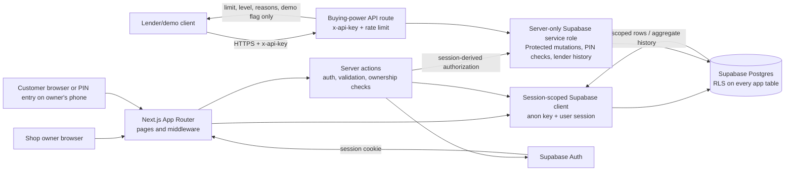

# tapUP Architecture

## 1. Scope and folder structure

This is a server-rendered Next.js App Router application, hosted on Vercel and backed by
Supabase Auth and Postgres. The browser uses the Supabase publishable/anon key only. Reads
use session-scoped queries constrained by RLS. Sale and repayment mutations run in
server-only actions because they involve protected token/PIN data; each action must derive
the caller from the session and recheck ownership. Database constraints and triggers enforce
sale transitions, tender totals, consent, limits, and repayment bounds.
Payments are simulated, the buying-power rules are deterministic, and every limit belongs to
one shop/customer relationship.

`docs/FILE_STRUCTURE.md` is confirmed and aligned with the root app/config files (including
`vitest.config.mts`), the auth action module, and the request/PIN operations listed below.
The customer’s request and shopkeeper’s approval are separate steps; the shopkeeper remains
the decision-maker for every tab.

```text
tapup/
├─ app/
│  ├─ layout.tsx
│  ├─ globals.css
│  ├─ page.tsx
│  ├─ (auth)/login/page.tsx
│  ├─ (auth)/signup/page.tsx
│  ├─ shop/sell/page.tsx
│  ├─ shop/ledger/page.tsx
│  ├─ shop/customers/new/page.tsx
│  ├─ pay/[token]/page.tsx
│  ├─ me/page.tsx
│  └─ api/
│     ├─ v1/buying-power/route.ts
│     └─ health/route.ts
├─ components/
│  ├─ BarcodeScanner.tsx
│  ├─ Cart.tsx
│  ├─ SaleQr.tsx
│  ├─ LimitMeter.tsx
│  ├─ WhyLimit.tsx
│  ├─ CustomerRow.tsx
│  └─ DemoBanner.tsx
├─ lib/
│  ├─ money.ts
│  ├─ buyingPower.ts
│  ├─ forecast.ts
│  ├─ pin.ts
│  ├─ qr.ts
│  ├─ validation.ts
│  ├─ rateLimit.ts
│  ├─ products.ts
│  ├─ supabase/client.ts
│  ├─ supabase/server.ts
│  └─ actions/
│     ├─ auth.ts
│     ├─ sales.ts
│     ├─ tabs.ts
│     └─ customers.ts
├─ middleware.ts
├─ public/
│  ├─ manifest.webmanifest
│  └─ icons/
├─ supabase/
│  ├─ schema.sql
│  ├─ rls.sql
│  └─ seed.sql
├─ tests/
├─ scripts/
├─ docs/
├─ .env.example
├─ package.json
├─ package-lock.json
├─ next.config.ts
├─ tsconfig.json
├─ eslint.config.mjs
└─ vitest.config.mts
```

`docs/FILE_STRUCTURE.md` remains the detailed file-by-file ownership map. Root framework files,
`app/globals.css`, and `lib/actions/auth.ts` should be shown there as well. No route or
feature beyond the four product flows is introduced here.

## 2. Pages, actions, and API permissions

All role checks happen on the server as well as in navigation/UI. A hidden button is not an
authorization check. Supabase Auth identifies email/password accounts; phone-only customers
are shop-managed records and do not get a customer login.

### Pages

| Route | Who may open it | Purpose and boundary |
|---|---|---|
| `/` | Anyone; signed-in users are redirected by role | Welcome page for logged-out users; shop owners go to `/shop/sell`, customers to `/me`. |
| `/login` | Anyone not signed in | Supabase email/password sign-in. |
| `/signup` | Anyone not signed in | Create an account as a shop owner or smartphone customer; owners also create a shop. |
| `/shop/sell` | Signed-in shop owner | Their shop’s sell/cart flow, QR creation, and phone + PIN tab approval. |
| `/shop/ledger` | Signed-in shop owner | Their own customers, sales, balances, and repayment controls. |
| `/shop/customers/new` | Signed-in shop owner | Create a phone-only customer or link a consenting customer account; PIN is set by the customer on this device. |
| `/pay/[token]` | Signed-in smartphone customer linked to the sale’s shop | View a pending sale and choose tab, simulated card/wallet, or cash. A QR token is not a substitute for customer authentication. |
| `/me` | Signed-in smartphone customer | See only their own shop-specific buying power, reasons, and forecast. |

Barcode scanning, cart, payment confirmation, PIN entry, and repayment confirmation are
components or states within those routes, not additional pages. Phone-only customers enter
their PIN on the owner’s authenticated `/shop/sell` device; they do not visit `/pay/[token]`.

### Server actions

Mutations use server actions, validate their inputs with strict Zod schemas, derive the acting
user and shop from the authenticated session, and check ownership/consent again in the
database operation. Never accept the client’s total, limit, role, or shop ID as authority.

| Action | Caller | Responsibility |
|---|---|---|
| `signUp` | Public | Validate role and fields, create the Supabase Auth user and profile; create a shop for a shop owner. |
| `signIn` | Public | Authenticate with Supabase Auth and establish the session. |
| `signOut` | Signed-in user | End the current session. |
| `createSale(items)` | Shop owner | Recompute total from the server catalogue, create a pending sale, and return its random QR token once; persist only its hash and five-minute expiry. |
| `requestTab(saleId, paidNowMethod?)` | Linked smartphone customer | Set `tab_cents` and `paid_now_cents` from the available limit, then atomically transition `pending` to `tab_requested`; any cash remainder remains unconfirmed until the owner records receipt. |
| `requestCash(saleId)` | Linked smartphone customer | Atomically record the cash choice and consume the QR while the sale remains pending; it is not proof that cash was received. |
| `approveTab(saleId, shopCustomerId, pin?)` | Owning shop owner | Confirm consent and customer identity, verify a phone-only customer’s PIN in this same server operation, enforce the current per-shop limit, set the due date, and approve the tab. |
| `payCash(saleId, shopCustomerId?)` | Owning shop owner | Confirm receipt of a cash request by recording `paid_now_confirmed_at`; mark a full cash sale paid or enable approval of the requested tab. |
| `demoPay(saleId)` | Linked smartphone customer | Confirm the simulated card/wallet portion by recording `paid_now_confirmed_at`; mark a full-pay sale paid or leave a split sale awaiting owner approval. Collect or store no card data. |
| `addCustomer(name, phone, consent)` | Shop owner | Create a phone-only customer record and timestamp consent; reject missing consent and duplicate phone numbers within that shop. |
| `linkWithConsent(shopCustomerId, consent)` | Signed-in smartphone customer | Calls a restricted database function that links only the caller’s own profile when phone values match and consent is true. This is not phone verification; the owner confirms the person in front of them before tab approval. |
| `setCustomerPin(shopCustomerId, pin)` | Owning shop owner’s device, with the customer entering the PIN | Validate four digits, hash server-side, and store only the hash. |
| `verifyCustomerPin(shopCustomerId, pin)` | Server-only helper called inside `approveTab` | Verify through server-only access, enforce the five-try/15-minute lockout, and never return the PIN, hash, or a client-trustable “verified” result. |
| `repayTab(saleId, amountCents)` | Owning shop owner | Record a positive repayment no greater than the outstanding balance, determine timeliness from the due date, and mark the sale repaid when fully settled. |

`requestTab` changes the sale to `tab_requested`, the explicit waiting-for-owner state.
`requestCash` records a cash intent while status remains `pending`; neither is proof of
payment or tab approval. The owner’s sell/ledger UI must show these requests and require an
explicit owner action for a tab or cash receipt. Refreshing the owner view is an acceptable
MVP update mechanism; push notifications are out of scope. State changes must be
conditional/atomic so a stale or replayed request cannot approve or settle a sale twice.

### API routes

| Method and route | Who may call it | Response and restrictions |
|---|---|---|
| `GET /api/v1/buying-power?shop=<uuid>&customer=<uuid>` | A lender/demo client with the `x-api-key` matching server-only `LENDER_API_KEY` | `401` for an invalid key, `400` for invalid IDs, `429` when rate limited. Success returns only `{ limitCents, level, reasons, demo: true }`; no names, phone numbers, or sale history. |
| `GET /api/health` | Public uptime checker | Cheap database check; return only `{ ok: true }` on success and a non-success status if unavailable. Never expose rows, errors, or credentials. |

The lender API is a demonstration of the planned data product, not a real lender integration
or credit decision. Compare keys in constant time, rate limit requests, and keep the service
role and lender key on the server. In-memory rate limits are acceptable only for the demo;
production needs a shared store. The route reads only the selected shop/customer relationship
and that pair’s sales/repayments to calculate buying power.

## 3. Data model and flow sequences

Supabase Auth owns `auth.users`. The application tables are:

| Table | Purpose |
|---|---|
| `profiles` | Auth user role and minimal account details. |
| `shops` | Shop ownership and shop-specific identity. |
| `shop_customers` | The customer/shop relationship, consent, owner confirmation, optional customer profile, PIN security state, and cached per-shop limit. |
| `sales` | Sale items, integer-cent total, payment method and state, token hash/expiry, due date, tender split, and immediate-payment confirmation. |
| `repayments` | Each partial or full repayment, its amount/time, and whether it was on time. |

All currency is integer cents. `shop_customers.credit_limit_cents` is a per-shop cached
result of the explainable scoring function, not a lender-provided limit. The score uses the
customer’s last 30 days at that shop only; cash purchases count at the agreed lower weight.
Limits move in R50 steps, cap at R300, and a new customer starts at R0 until their first
completed purchase. Available buying power is `max(0, credit_limit_cents - outstanding_tab)`.
Outstanding balance is the approved tab amount minus its repayments. Private PIN/QR fields
and lockout state are never exposed to browser reads; RLS applies to every table, and
privileged reads/writes stay server-side.

The MVP uses email/password rather than phone OTP. A matching phone value is not proof of
phone ownership: smartphone customers must initiate their own account link and consent, and
the shop owner must confirm the customer in person before approving a tab. Do not describe
these phone numbers as verified.

The sales schema represents a split with integer `tab_cents` and `paid_now_cents`; those
amounts must equal `total_cents` for approved, repaid, and paid sales. `paid_now_method`
records `demo_card` or `cash`, and `paid_now_confirmed_at` distinguishes a simulated payment
or owner-confirmed cash receipt from a cash request. A tab request moves through
`pending` → `tab_requested` → `approved` → `repaid`; a full payment moves from `pending` to
`paid`. Database checks and transition triggers prevent over-total splits, invalid status
jumps, QR reuse, and concurrent approvals above available buying power. Repayments are
locked and bounded against the outstanding tab in a database trigger.

### A. Shop QR sale and customer tab request

1. The signed-in shop owner adds items. `createSale` loads trusted catalogue prices and
   recomputes the total in cents.
2. Insert a `sales` row with `status='pending'`, `method='pending'`, items, total, a hash of a
   random token, and `expires_at` five minutes ahead. Return the raw token once to render the
   QR; never store it.
3. The signed-in smartphone customer opens the token URL. The server finds the sale by token
   hash, verifies it is pending and unexpired, and matches the customer’s authenticated
   profile to the `shop_customers` row for that sale’s shop. Read `sales` and
   `shop_customers`; do not reveal whether an invalid token was expired, used, or unknown.
4. If the customer requests tab, `requestTab` matches them to the shop relationship and
   computes `tab_cents = min(total_cents, available_limit_cents)` on the server. It changes
   `status` from `pending` to `tab_requested`, records that split, and consumes the QR once.
   The remainder is `paid_now_cents`. The browser cannot directly mutate sale rows; the
   server action verifies the session and performs a conditional write, while DB triggers
   enforce allowed state transitions and tender rules.
   Read `shop_customers`, `sales`, and `repayments` to verify the relationship and calculate
   outstanding balance; update `sales` conditionally. If the available limit is zero, reject
   the tab request and offer full payment instead.
5. The customer chooses a simulated card/wallet or cash for any remainder. `demoPay` records
   a simulated immediate tender; for cash, the selection remains unconfirmed until the owner
   records receipt through `payCash`. A full-sale cash request remains pending; a mixed sale
   remains `tab_requested`. Neither action approves the tab.
6. The owner sees the pending request and explicitly approves it. `approveTab` rechecks
   ownership, consent, PIN if applicable, immediate remainder, current limit and outstanding
   balance, then atomically changes the sale to `status='approved'` and sets
   `approved_at`/`due_at`. It reads/updates `shop_customers` and updates `sales`. No tab is
   created if approval fails.
7. The result is included in this shop/customer’s scoring history. Update the cached
   `shop_customers.credit_limit_cents` when the scoring rules say the limit has changed.

The QR is single-use: state-changing actions require the expected pending state and use an
atomic conditional update/transaction. Once a payment choice is recorded or the sale advances
to approved/paid, that token cannot start another sale action. Expiration and use have the
same customer-facing invalid-link message.

For a full simulated-card sale, `demoPay` records `paid_now_cents=total_cents`,
`paid_now_method='demo_card'`, and payment confirmation; with no tab portion it sets
`status='paid'`. For a split sale it records only the remainder and leaves the tab in
`tab_requested` until owner approval. A customer choosing cash records a cash intent; the
owner confirms receipt through `payCash`. A sale with an approved tab remains
`status='approved'` until the tab portion is repaid.

### B. Phone + PIN tab for a customer without a smartphone

1. The signed-in owner looks up or adds the customer by phone. `addCustomer` requires
   consent and records `consent_at` in `shop_customers`; the phone is unique within the shop.
2. The customer enters a four-digit PIN on the owner’s device. `setCustomerPin` hashes it
   server-side and stores only `shop_customers.pin_hash`; consent must already exist.
3. The owner creates a sale on the authenticated sell page without a public customer QR;
   the phone-only customer record is attached when the owner starts PIN approval.
4. The owner selects the phone-only customer. The customer enters the PIN; the server-only
   `verifyCustomerPin` helper checks the stored hash and applies lockout state in
   `shop_customers` after five failures for 15 minutes.
5. `approveTab` verifies the owner/shop relationship, consent, PIN (in the same server-side
   operation, not via a client-supplied “verified” flag), sale amount and available per-shop
   limit. In one transaction it records `pending` → `tab_requested` → `approved`, updating
   `sales` and any needed `shop_customers` confirmation atomically. No PIN or hash is sent to
   the browser or written to logs.

### C. Cash sale logged against a customer

1. The owner selects or adds the customer. A new record requires consent before association;
   `addCustomer` writes `shop_customers`.
2. The owner creates the sale. `createSale` recomputes its item total and inserts pending
   `sales`.
3. After receiving cash, the owner invokes `payCash`. The server verifies shop ownership,
   links the correct `shop_customers` record, and atomically records the full
   `paid_now_cents`, `paid_now_method='cash'`, `paid_now_confirmed_at`, and
   `status='paid'` in `sales`.
4. The sale appears in that shop’s ledger and customer history. Recompute the cached limit
   from this shop’s history; cash contributes at the lower weight defined in
   `lib/buyingPower.ts`. This touches `sales` and `shop_customers`.

### D. Customer repays a tab; shopkeeper records it

1. The owner opens an outstanding approved sale from their own ledger. Read `shops`,
   `shop_customers`, `sales`, and its `repayments`, checking ownership and remaining amount.
2. After receiving repayment, the owner invokes `repayTab(saleId, amountCents)`. Validate
   `0 < amountCents <= outstanding` on the server.
3. In one transaction, insert a `repayments` row with `paid_at` and `on_time` derived from
   `sales.due_at`; recompute the tab balance as `tab_cents` minus repayments. Leave
   the sale approved for a partial repayment or set `sales.status='repaid'` when the tab
   portion is fully settled.
4. Recompute this customer’s shop-specific buying power and update
   `shop_customers.credit_limit_cents`. The ledger, repayment history and customer view then
   read the updated rows.

The four sequences use `profiles`/`shops` to establish authenticated ownership; the tables
listed at each step are the rows read or changed for the actual flow.

## 4. Data flow



Browser requests enter the Next.js app. Authenticated reads and permitted profile/shop writes
use a session-scoped Supabase client, so Postgres RLS restricts rows even if an app check is
missed. Sale, repayment, and PIN mutations use server-only privileged operations because they
touch protected columns or must execute atomically; those actions must revalidate the session,
role, shop ownership, and inputs before writing. Database triggers independently enforce the
sale state machine, consent, available limits, and repayment bounds. The service role is never
sent to a browser. The lender receives only an aggregate buying-power response, while payment
buttons update demo records and never connect to a payment processor.

## 5. Environment variable names

Put values only in the local/deployment environment, never in source control. `.env.local`
must remain gitignored.

| Variable | Use |
|---|---|
| `NEXT_PUBLIC_SUPABASE_URL` | Supabase project URL; public configuration, not a secret. |
| `NEXT_PUBLIC_SUPABASE_ANON_KEY` | Publishable/anon key for session-aware client setup; database access still depends on RLS. |
| `SUPABASE_SERVICE_ROLE_KEY` | Server-only access for protected sale/repayment mutations, PIN checks, and the lender route; never prefix with `NEXT_PUBLIC_`. |
| `LENDER_API_KEY` | Server-only secret required by the demo buying-power API caller. |
| `NEXT_PUBLIC_APP_URL` | Public app origin used to build absolute sale QR links. |

## 6. Top eight risks and mitigations

| # | Risk | One-line mitigation |
|---|---|---|
| 1 | Cross-shop or cross-customer data access (IDOR). | Enable RLS on every table and scope every query to the authenticated profile and owned shop; test negative access cases. |
| 2 | A forged or concurrent tab exceeds the customer’s available limit. | Recompute totals, limit and outstanding balance server-side, then approve with an atomic transaction/conditional update. |
| 3 | Sale QR is guessed, leaked, reused, or accepted after expiry. | Generate at least 128 random bits, store only a hash, enforce five-minute expiry, atomically consume the pending state once, and prevent token referrer/log leakage. |
| 4 | PIN theft or brute force. | Hash with bcrypt on the server, never expose/log PIN hashes, rate limit, and lock for 15 minutes after five failures. |
| 5 | Service-role or lender credentials leak. | Keep secrets in server-only environment variables, never expose the service role to the client, and compare the lender key in constant time. |
| 6 | Tampered input, item price, or currency arithmetic changes a sale. | Strictly validate inputs, reject unexpected fields, look up catalogue prices on the server, and use integer cents. |
| 7 | Personal data is collected or disclosed without consent or need. | Require and timestamp POPIA consent, minimize stored fields, isolate shop/customer rows, and return no identity/history through the lender API. |
| 8 | Abuse or outages defeat rate limits or availability. | Rate limit login, PIN, and API calls; treat in-memory limits as demo-only, use a shared production limiter, HTTPS, health checks, and clear retry/fallback states. |

## 7. Live demo failures and fallbacks

| What can go wrong | Fallback |
|---|---|
| Camera permission is denied, no camera exists, or scanning is unreliable. | Use the manual product list/barcode entry on the Sell screen. |
| Only one phone is available to show and scan a QR. | Open the displayed pay URL on a second device, or demonstrate the phone + PIN approval flow on the owner’s phone. |
| Network or Supabase is slow/unavailable. | Show the retry/error state; switch to a pre-recorded demo video/screenshots and clearly label them as a fallback, not a live transaction. |
| Demo database is empty or seeded rows are missing. | Use the documented demo accounts, verify the seed, and reseed/recreate the demo shop and customer before presenting. |
| Login, email confirmation, or judge credentials fail. | Use the second documented judge account; confirm demo users and auth settings before the presentation. |
| QR expires or has already been used. | Create a fresh sale and QR; explain that expiry/reuse rejection is the intended security behavior. |
| The owner is not available to confirm a tab or cash request. | Use the PIN flow with the owner present or demonstrate a simulated card payment; never imply a tab is automatically approved. |
| Public deployment has missing env vars or database access. | Check `/api/health` before the demo; if it fails, use the labelled recording/screenshots rather than showing a broken or fabricated success. |

## 8. Agent 4 build order: working slice early

Follow the agreed order and keep each step runnable:

1. **Project setup and auth:** add session-aware Supabase clients, login/signup/sign-out,
   role/profile/shop creation, and role guards. Verify both judge roles can sign in.
2. **Sell + Pay with shop QR:** build the demo catalogue, cart, server-priced sale creation,
   five-minute QR, token validation, and demo card/cash paths. Complete one end-to-end sale
   with a seeded customer before starting the remaining screens.
3. **Buying power:** implement `/me`, explainable reasons and forecast using the shared scoring
   functions; show only the signed-in customer’s shop relationship.
4. **Ledger:** show owner-scoped takings, tabs and customer rows; wire repayment and verify
   balances/limits update after repayment.
5. **Phone + PIN:** add the consented phone-only customer path, server-side PIN hashing,
   verification and lockout, then require explicit owner approval for the tab.
6. **Polish states:** add loading/empty/error/retry states, mobile tap targets, PWA metadata and
   the demo banner. Run security checks and the smoke test before release.

At every stage keep totals in integer cents, follow `docs/DESIGN_SPEC.md`, and avoid adding
features outside its four flows. A working QR sale is the first vertical slice; do not wait
for the ledger or PWA polish before validating it.
