# tapUP design spec (the agents must match these screens)
<!-- WHY: images alone are easy to misread. This file lists each screen image with the exact
text, numbers and behaviour, so the Frontend agent builds what you designed. Images sit next
to this file in docs/design/. Paste this file AND attach the images when running agent 4. -->

**IMPORTANT: the images are mock-ups. Every number, name and amount in them is placeholder.
Match the layout, text, colours and behaviour. All numbers must come from the backend (database + lib/buyingPower.ts), never hard-coded from an image.**

Design system image: 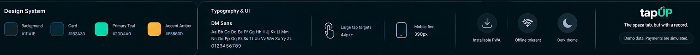
Tokens: background #111A1E, card #1B2A30, primary teal #2DD4A0, accent amber #F5B83D, font DM Sans,
tap targets 44px+, mobile first 390px, installable PWA, offline tolerant, dark theme.
Footer pill on the main screens: "Demo data. Payments are simulated."
Tagline: "The spaza tab, but with a record."  Logo text: tapUP (teal "UP" with a small upward arrow).

## Screen list (file, route, role, what it does)

### 01 Splash / Welcome  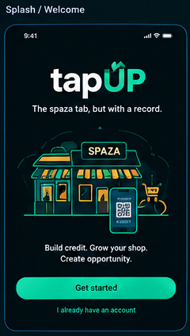
Route: `/` (when logged out). Logo, tagline, spaza illustration, text "Build credit. Grow your shop. Create opportunity."
Buttons: "Get started" (primary) -> signup; "I already have an account" (link) -> login.

### 02 Login  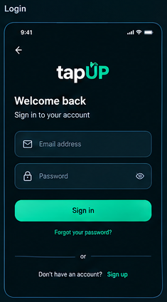
Route: `/login`. Title "Welcome back", "Sign in to your account". Fields: Email address, Password (eye toggle).
Button "Sign in". Link "Forgot your password?" (optional: build only if time allows, otherwise hide it).
Footer: "Don't have an account? Sign up".

### 03 Signup: role selection  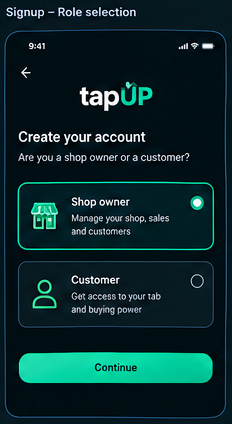
Route: `/signup`. "Create your account. Are you a shop owner or a customer?"
Two radio cards: Shop owner ("Manage your shop, sales and customers"), Customer ("Get access to your tab and buying power").
Button "Continue" -> then email + password + name step (not shown in design; keep it minimal).

### 04 Shop: Sell (main)  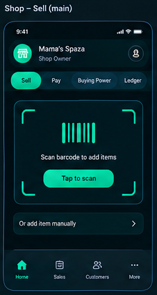
Route: `/shop/sell`. Header: shop icon, shop name "Mama's Spaza", subtitle "Shop Owner", profile icon.
Top pill tabs: Sell, Pay, Buying Power, Ledger. Card: "Scan barcode to add items" with "Tap to scan" button.
Row: "Or add item manually". Bottom nav: Home, Sales, Customers, More.
NOTE: in the real app show only the tabs for the logged-in role (shop owner: Sell and Ledger; customer: Pay and Buying Power).

### 05 Barcode scanner  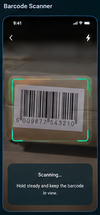
Full-screen camera with a teal corner frame, back arrow, torch icon. Text "Scanning... Hold steady and keep the barcode in view."
Camera denied or no camera -> fall back to manual add.

### 06 Cart ("New Sale")  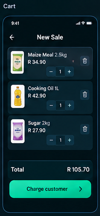
Each line: product image, name, price, quantity stepper (- 1 +), delete icon.
Sample: Maize Meal 2.5kg R34.90, Cooking Oil 1L R42.90, Sugar 2kg R27.90. Total R105.70.
Button "Charge customer >". Use these three as demo catalogue items with images.

### 07 Sale QR (shopkeeper)  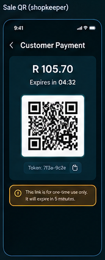
Title "Customer Payment". Amount R105.70. "Expires in 04:32" countdown. Large QR. Token chip with copy icon (show only a short token ending, never the full secret).
Warning box: "This link is for one-time use only. It will expire in 5 minutes."
=> Sale token expiry is 5 MINUTES (this overrides the 10 minutes in agent 3's first draft).

### 08 Pay (customer)  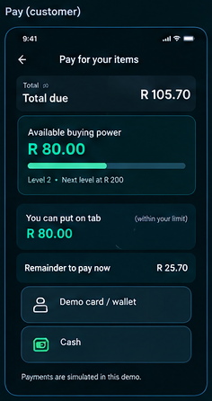
Title "Pay for your items". Total due R105.70. Card "Available buying power R80.00", progress bar, "Level 2 . Next level at R200".
"You can put on tab R80.00 (within your limit)". "Remainder to pay now R25.70".
Buttons: "Demo card / wallet", "Cash". Footnote "Payments are simulated in this demo."
Logic: tab amount = min(total, available limit); remainder = total - tab.

### 09 Expired / used token  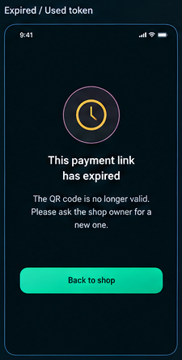
Clock icon, "This payment link has expired", "The QR code is no longer valid. Please ask the shop owner for a new one."
Button "Back to shop". Use the same screen for used and invalid tokens (do not reveal which).

### 10 Buying power (customer)  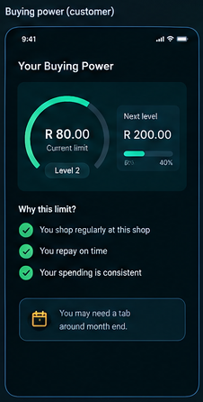
"Your Buying Power". Ring gauge R80.00 "Current limit", "Level 2". Side card "Next level R200.00" with progress 40%.
"Why this limit?" with check items: "You shop regularly at this shop", "You repay on time", "Your spending is consistent".
Card: "You may need a tab around month end." (this is the forecast flag).

### 11 Ledger (shop)  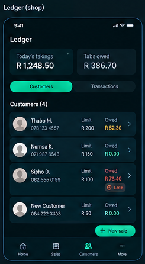
Title "Ledger". Two stat cards: "Today's takings R1,248.50", "Tabs owed R386.70". Segmented control: Customers | Transactions.
"Customers (4)" rows: avatar, name, phone, Limit, Owed (amber if owed, teal if zero, red with a "Late" chip if overdue).
Sample rows: Thabo M. 078 123 4567 limit R200 owed R230 (amber; the image text is garbled, treat as R230.00? confirm), Nomsa K. 071 987 6543 limit R150 owed R0,
Sipho D. 082 555 0199 limit R100 owed R78.40 LATE, New Customer 084 222 3333 limit R50 owed R0. Button "+ New sale".

### 12 Add customer (shop)  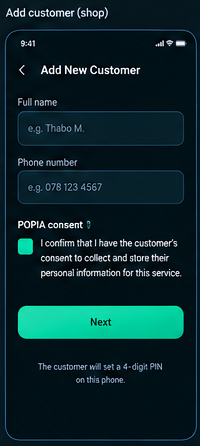
Fields: Full name (placeholder "e.g. Thabo M."), Phone number (placeholder "e.g. 078 123 4567").
"POPIA consent" checkbox: "I confirm that I have the customer's consent to collect and store their personal information for this service."
Button "Next" (disabled until ticked). Footer "The customer will set a 4-digit PIN on this phone."

### 13 PIN approval  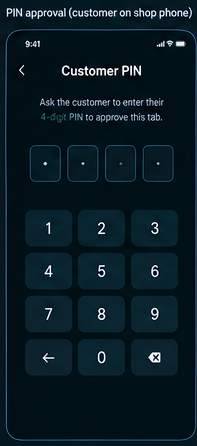
"Customer PIN. Ask the customer to enter their 4-digit PIN to approve this tab." Four dots, numeric keypad, backspace.
After 5 wrong tries: lock for 15 minutes with a clear message. Never show or log the PIN.

### 14 Mark repaid (shop)  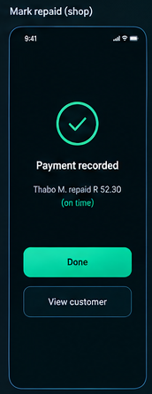
Check icon, "Payment recorded", "Thabo M. repaid R 52.30 (on time)" (green "on time"; amber/red "late" when after the due date).
Buttons "Done", "View customer".

## Decisions already made (so nothing blocks the build; I can tune them later)
1. Numbers in the images are placeholders. The backend computes limits, totals and balances.
2. Limit steps are R50 (R0, R50, R100 ... R300 cap). Set in lib/buyingPower.ts only.
3. A new customer starts at R0 and reaches R50 after their first completed purchase. Backend rule, not UI.
4. Sale QR expires in 5 minutes.
5. Navigation is role-based: shop owner sees Sell and Ledger; customer sees Pay and Buying Power.
6. "Forgot your password?" is hidden unless time allows.
